<!-- VinayCodes17 | Compact, widget-first profile -->

  

<h3 align="center">Backend Engineering · System Design · Distributed Systems</h3>

  CSE @ IIIT Nagpur &nbsp;·&nbsp; Building APIs and practical software systems

  
  
  

---

## 3D Contribution City

  
   
  <a href="https://gitcity.natrajx.in/VinayCodes17"><strong>↗ ENTER THE CITY · EXPLORE & DRIVE THROUGH MY CONTRIBUTIONS</strong></a>

## Stack

  

  APIs · Databases · Microservices · Caching · Containers · System Design
   
  Exploring: Redis · RabbitMQ · Kafka · Kubernetes · Observability

  
  

## GitHub at a glance

  
  

  

## Activity timeline

  

## Animated contribution FX

  <picture>
    <source media="(prefers-color-scheme: dark)" srcset="https://raw.githubusercontent.com/VinayCodes17/VinayCodes17/output/contribution-fx-dark.svg" />
    
  </picture>

## Milestones

  

  <a href="https://github.com/VinayCodes17">GitHub</a>
  &nbsp;·&nbsp;
  <a href="https://github.com/VinayCodes17?tab=repositories">Projects</a>

  

