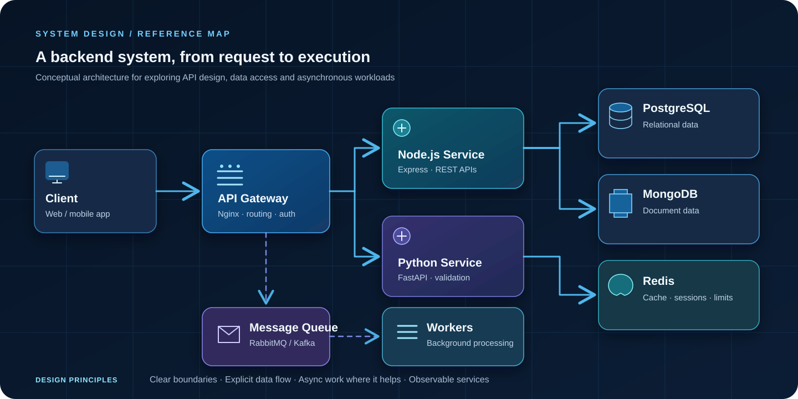
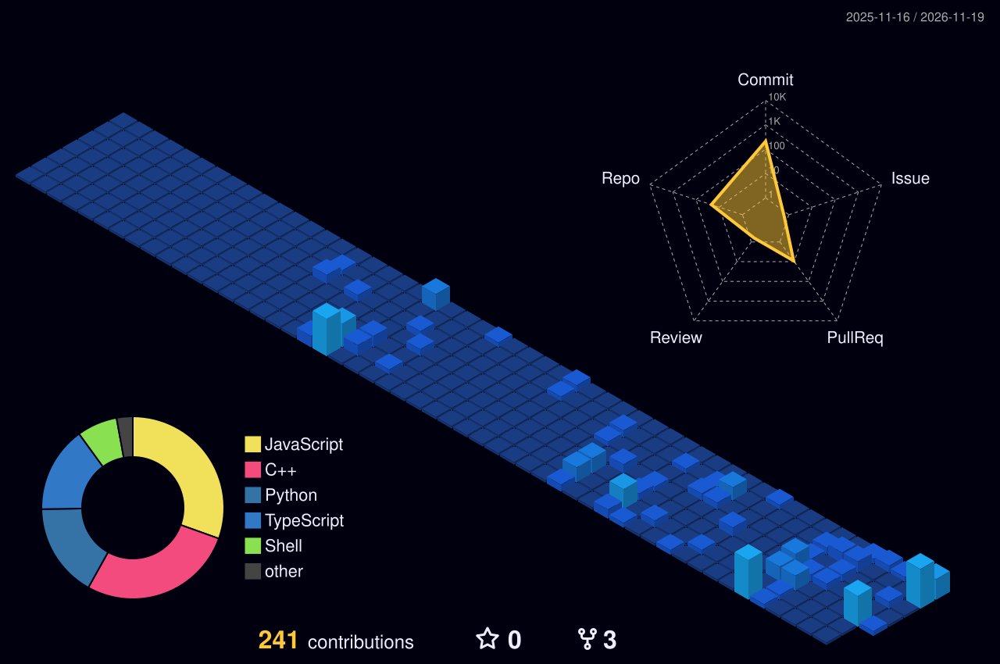

<!--
  PROFILE README — VinayCodes17
  Replace or remove any project / contact details that have changed before publishing.
  The hero banner and system map are stored locally in ./assets.
-->

<p align="center">
  
</p>

<h1 align="center">Hi, I'm Vinay</h1>

<p align="center">
  <a href="https://github.com/VinayCodes17">
    
  </a>
</p>

<p align="center">
  <a href="https://github.com/VinayCodes17"></a>
  <a href="https://github.com/VinayCodes17?tab=followers"></a>
  <a href="https://github.com/VinayCodes17?tab=repositories"></a>
</p>

---

## About Me

I'm a Computer Science student at **IIIT Nagpur**, focused on backend engineering and building practical software systems.

I enjoy understanding how things work beneath the abstractions — from request lifecycles and API design to database modelling, caching, containerization and deployment. I learn best by building end-to-end projects, debugging them and understanding the trade-offs behind each design decision.

- Backend-focused development with **Node.js, Express.js and FastAPI**
- Designing and integrating **REST APIs**, authentication and data layers
- Working with **MongoDB, PostgreSQL and Docker-based environments**
- Exploring **distributed systems, system design and infrastructure**

## Engineering Focus

<table>
  <tr>
    <td width="33%" valign="top">
      <h3>API Engineering</h3>
      <p>Designing clear API boundaries, request validation, authentication flows and maintainable service layers.</p>
    </td>
    <td width="33%" valign="top">
      <h3>Data & Performance</h3>
      <p>Understanding data modelling, query patterns, caching strategies and the trade-offs behind storage choices.</p>
    </td>
    <td width="33%" valign="top">
      <h3>Infrastructure</h3>
      <p>Containerizing applications, configuring reverse proxies and learning how applications run beyond local development.</p>
    </td>
  </tr>
</table>

## Technology Stack

**Languages**

<p>
  
</p>

**Frontend & Motion**

<p>
  
</p>

**Backend & APIs**

<p>
  
</p>

**Databases**

<p>
  
</p>

**Developer Tools & Infrastructure**

<p>
  
</p>

**Currently Exploring**

`Redis` · `RabbitMQ` · `Kafka` · `gRPC` · `Linux` · `GitHub Actions` · `Kubernetes` · `Prometheus` · `Grafana`

<sub>The “Currently Exploring” list represents topics I'm actively learning or investigating, not a claim of production-level proficiency.</sub>

## Architecture & Systems Thinking

I like breaking systems into clear components and understanding how requests, data and background work move through them. This is a **reference architecture for concepts I'm exploring**, not a diagram of one deployed application.

<p align="center">
  
</p>

## Selected Work

### OceanEmbed · Oceanographic Data Reconstruction

A hackathon project exploring the reconstruction and visualization of ocean temperature profiles from oceanographic inputs.

- **Backend direction:** FastAPI and Python-based API orchestration
- **Data layer:** PostgreSQL / PostGIS with Redis caching concepts
- **Processing direction:** Background processing and containerized deployment
- **Focus:** Geospatial data, scientific workflows and practical backend design

<sub>Project details and implementation evolve; visit my repositories for the latest code and status.</sub>

<p>
  <a href="https://github.com/VinayCodes17?tab=repositories"></a>
</p>

## Recognition

- **IEEE HACKSAGON 2026** — Finalist; selected among the top teams from 2,100+ participants / teams.
- **GirlScript Summer of Code 2026** — Open-source contributor.

## GitHub Analytics

<p align="center">
  
  
</p>

<p align="center">
  
</p>

<p align="center">
  
</p>

## 3D Contribution Calendar

<p align="center">
  
</p>

## Contribution Activity

<p align="center">
  <picture>
    <source media="(prefers-color-scheme: dark)" srcset="https://raw.githubusercontent.com/VinayCodes17/VinayCodes17/output/github-snake-dark.svg" />
    <source media="(prefers-color-scheme: light)" srcset="https://raw.githubusercontent.com/VinayCodes17/VinayCodes17/output/github-snake.svg" />
    
  </picture>
</p>

## Engineering Principles

```text
Understand the system before changing it.
Clarity over unnecessary complexity.
Measure performance; don't guess.
Build for maintainability, not just the demo.
Depth of understanding over surface-level familiarity.
```

## Let's Connect

I'm interested in meaningful engineering conversations, collaborative projects and opportunities to learn by building.

<p align="center">
  <a href="https://github.com/VinayCodes17"></a>
  <!-- Add your LinkedIn and public contact email here when ready. -->
</p>

---

<p align="center">
  
</p>
